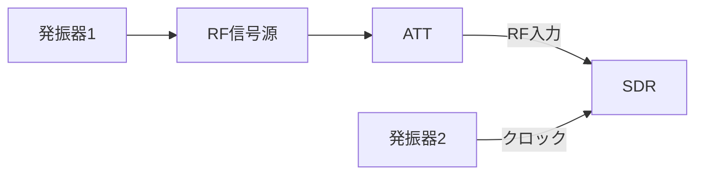

# sdr_allan_deviation

SDRを用いて発振器のアラン偏差を評価する。
電波干渉系の周波数標準を評価する目的で作成した。

アラン偏差計算の核心部分はallan_toolsに依存しており、このプロジェクトはデータの前処理と可視化を行う。

## ハードウェア構成

アラン偏差の評価は通常ミキサーを用いて2つの発振器の周波数差を測定することで行われる。
ここではSDRの片方の発信機をSDRのクロックとして使用することでSDRに搭載されたミキサーを利用する。



発振器1と2で同じものを二つもしくは評価したい発振器より安定なものを使用する。1つの発信機を接続した場合はクロックの安定度は評価できないがSDRの位相雑音等を評価できる。

## 使用方法

1. IQデータを以下のいずれかの形式で保存する。

- `.wav`: 2チャンネル（1ch = I、2ch = Q）
- `.raw`: little-endian int16 の `[RX1_I, RX1_Q, RX2_I, RX2_Q]`
- `.dat`: USRPのヘッダなし little-endian sc16（`[I, Q]`）

どの形式も読み込み後は `complex64`、振幅は概ね -1〜1 に正規化される。

2. ```src/sdr_allan_deviation/config.py```に適切なパラメータを設定する。

- SOURCE_RATE_HZ: 入力IQのサンプリングレート。ヘッダのない `.raw` / `.dat` では必須
- TARGET_RATE_HZ: データを保存するレート
- REFERENCE_HZ: 周波数標準の周波数
- BIN_SECONDS: データをビンにする時間
- SIGNAL_PLOT_SECONDS: 信号をプロットする時間
- MAX_TAU_SECONDS: アラン偏差を評価する最大時間
- TAUS: アラン偏差を評価する時間。`None` の場合はオクターブ間隔
- OBSERVATION_FREQUENCY: 周波数標準の周波数
- LOWPASS_HZ: 低域フィルタのカットオフ周波数
- HIGHPASS_HZ: 高域フィルタのカットオフ周波数
- SKIP_SECONDS: データの先頭をスキップする時間

3. 以下のコマンドを実行する。

```bash
uv run main inputs/path/to/input.wav
```

20 MS/sで保存したヘッダなしsc16の場合は `SOURCE_RATE_HZ = 20_000_000.0` として
`uv run main inputs/path/to/input.dat` を実行する。

4. 結果が```outputs/```に保存される。

5. 結果が妥当かどうか以下の項目を確認する。

- signal_iq.pngを確認して下の段が正弦波に見えるか？
- power_spectrum.pngを確認して鋭いピークが立っているか？
- power_spectrum.pngを確認してピークがHPFとLPFの間にあるか？
- instantaneous_frequency.pngを確認してランダムっぽいノイズに見えるか？
